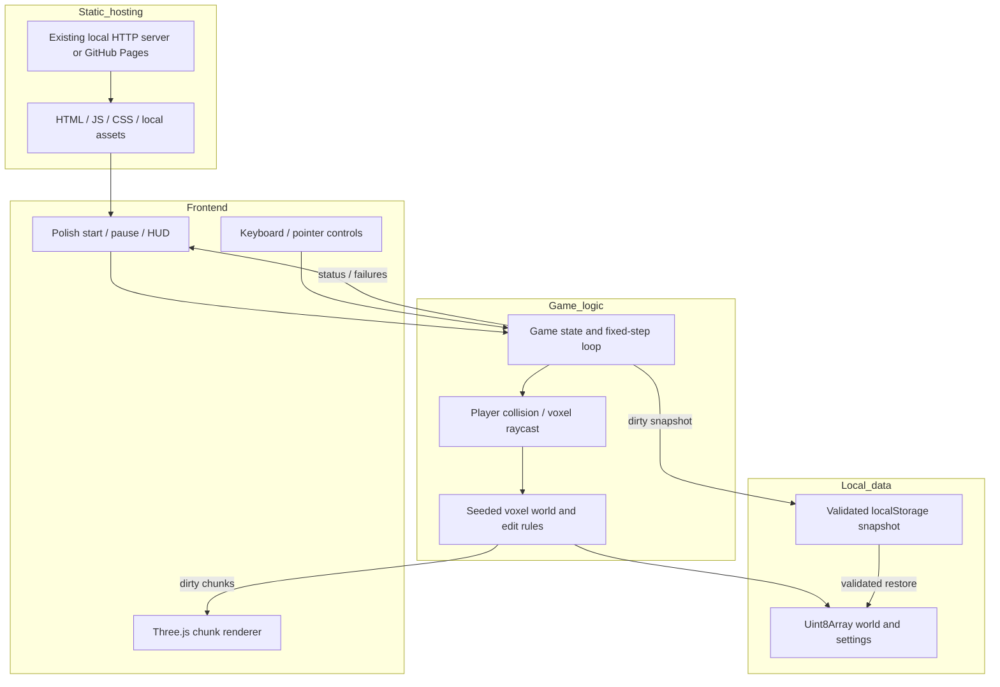
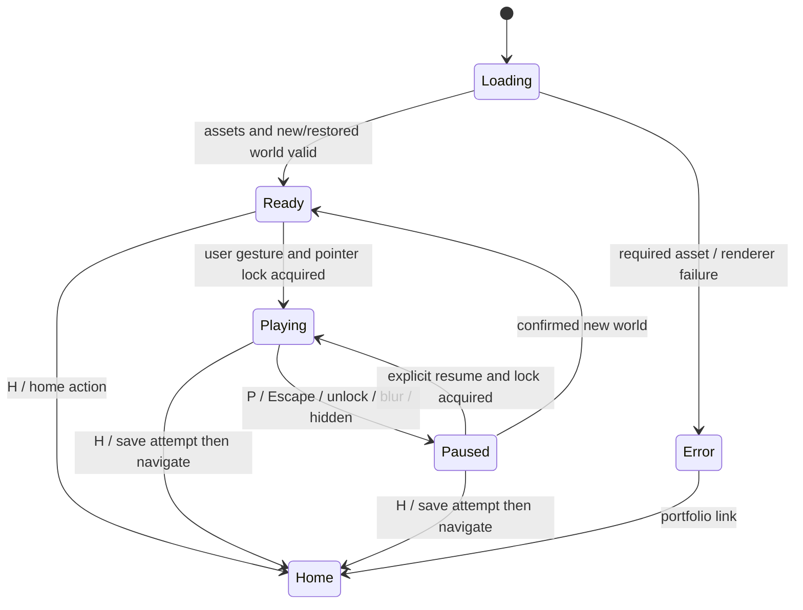

# Minecraft 0.3: release plan and voxel sandbox backlog

Initial assessment: 2026-11-10. Updated: 2026-11-12.
Status: **Saving, first-session polish and documentation implemented; the 0.4-to-0.3 migration was verified in Chrome Incognito with the original seed, position and material restored. Native pointer capture is verified; denial behavior, hosted-origin and full release-matrix checks remain pending.**

## Minecraft 0.3: active release plan

This section is the current plan for [Minecraft 0.3](../klocki-podlasia-0.3/).
It supersedes conflicting scope, storage, browser and release assumptions in the
historical 0.1 assessment below. It does not mark features implemented or authorize
tool installation, publication or changes to preserved versions.

### 0.3 goal and confirmed boundaries

**Explore, build, save, return.** A player can explore the existing world, build
with unlimited materials, leave and resume their creation without starting over.

| Area | Release decision |
|---|---|
| Supported platform | Desktop Mac with keyboard/mouse and WebGL2 |
| Supported browser | Standalone Google Chrome stable on macOS; record exact Chrome/macOS versions and hardware during verification |
| Other browsers | Safari, Firefox, Edge and embedded VS Code Chromium are not release targets; do not claim compatibility from Chrome results |
| Gameplay | Creative exploration and building; retain the existing world, materials, structures, animals and music |
| Persistence | One local world slot for 0.3, automatic and manual save, player/view/material/settings restore |
| Excluded from release blockers | Mobile/touch, survival, health/hunger, crafting, multiplayer, cloud sync, accounts and offline/PWA guarantees |
| Optional polish | Three dismissible building ideas: house, bridge and garden; no quests, rewards or resource requirements |
| Isolation | The renamed game lives in `klocki-podlasia-0.3/`; versions 0.1 and 0.2 remain preserved. The earlier tracked 0.3 implementation was intentionally removed with user approval on 2026-11-12; do not restore it over this release. Keep the `Minecraft-0.4` feature branch name and leave the existing `Minecraft-0.3` branch untouched. Preserve unrelated games/data. |

Use the current stable Chrome at the start of release testing and record its full
version. If Chrome updates before sign-off, repeat the critical smoke tests.
Select and record a reference Mac, macOS version, RAM, display/DPR and viewport;
do not infer support for every Mac from one machine. Test 1280x720 and compact
800x600 windows. Wider device coverage can follow this release.

### Implemented work and remaining gaps

- The [world model](../klocki-podlasia-0.3/world.js) has 2,097,152 cells
  (256 x 32 x 256), separate block/water byte arrays, seeded generation and
  validated edits.
- [Saving](../klocki-podlasia-0.3/saves.js) uses versioned, validated full-world
  typed-array snapshots in the `minecraft-0.3` IndexedDB database. It keeps one
  prior valid snapshot, checks revisions within the write transaction, and
  rejects damaged or incompatible data. It migrates the former
  `minecraft-0.4` database without deleting or overwriting that legacy copy.
  [Game integration](../klocki-podlasia-0.3/game.js)
  restores seed, edits, player/view, material and settings; autosaves, supports
  manual save, and protects pause/home/new-world flows with visible status.
- Standalone Chrome smoke checks verified save/reload, material/settings restore,
  damaged-current recovery from the previous copy, new-world cancel/replacement,
  block-edit persistence and cross-tab conflict handling. Injecting unavailable
  IndexedDB leaves the game playable but visibly unsaved and allows a retry.
- The rename migration was tested against the existing Chrome Incognito save.
  Version 0.3 restored the same seed, player position and selected material and
  reported the migration complete; the migration code leaves the old database
  untouched. Existing-target and damaged-legacy migration cases remain pending.
- The test suite passes **38/38**. Browser storage checks used temporary Chrome
  profiles, not the user's normal profile.
- Reference machine: macOS 27.2, Apple M3, 16 GiB RAM; standalone Chrome
  157.0.8103.78. Current app-level timings are from headless Chrome: 20 saves
  median 23.2 ms / p95 33.6 ms / max 36.9 ms, with no observed long tasks; 20
  validated restores median 25.9 ms / p95 42.9 ms / max 55 ms. These are local
  save timings, not frame-rate or hosted-load results.
- The [game README](../klocki-podlasia-0.3/README.md), [portfolio](../index.html),
  root [README](../README.md) and 0.3 preview now describe local saving and the
  intended support target. The optional house/bridge/garden ideas are collapsible
  and have no gameplay requirements.
- Native pointer capture and Escape-to-pause are verified in standalone Chrome
  157 on this Mac, using Incognito so the normal profile was untouched. Visible
  denial recovery, hosted `/gry-darka/klocki-podlasia-0.3/` loading,
  quota/transaction-abort injection and the full movement/render matrix are still
  **unverified**. Do not claim release sign-off.
- Node 26.13.1 is currently available on this Mac for tests; Node/npm are not
  needed to play the browser game.

### Work packages and execution order

Statuses below distinguish implemented work from the remaining release gates.

| ID | Deliverable | Prerequisites | Status and evidence |
|---|---|---|---|
| MC03-01 | Record Chrome/Mac baseline and freeze scope | None | **Recorded**; headless save benchmarks and native capture/Escape smoke test; full UI evidence remains in MC03-07 |
| MC03-02 | Measure snapshot size and storage feasibility | MC03-01 | **Complete**; full typed-array IndexedDB format selected |
| MC03-03 | Implement snapshot validation and transactional persistence | MC03-02 | **Implemented**; corruption/revision/storage-denial checks pass; normal migration verified; edge/quota/abort checks pending |
| MC03-04 | Integrate restore, autosave, manual save and lifecycle UX | MC03-03 | **Implemented and smoke-tested**; migration edge cases and broader lifecycle matrix pending |
| MC03-05 | Polish onboarding, building controls and destructive actions | MC03-04 | **Implemented**; fresh-player and native-browser playtest pending |
| MC03-06 | Add optional building ideas, if still useful | MC03-05 | **Complete**; collapsible ideas, no gameplay dependency |
| MC03-07 | Complete Chrome regression and performance gates | MC03-04, MC03-05 | **Pending**; see release matrix below |
| MC03-08 | Refresh preview, instructions and portfolio copy | MC03-05 | **Complete**; hosted-content verification remains MC03-09 |
| MC03-09 | Verify hosted candidate and obtain release approval | MC03-07, MC03-08 | **Pending**; no publish/approval claimed |

MC03-08 can proceed while MC03-07 runs. MC03-06 is not a prerequisite for either.
Estimate remaining implementation effort after MC03-02 rather than reusing the
historical full-game estimates below; those assumed a much smaller world.

### MC03-01/02: measured evidence and save-format decision

The current cell count is **2,097,152**. Calculated array payloads, excluding
metadata/encoding overhead, are:

| Representation | Calculated payload | Consequence |
|---|---:|---|
| Raw block bytes | 2 MiB | Already eight times the old 256 KiB whole-save cap |
| Raw block and water bytes | 4 MiB | Full authoritative snapshot candidate |
| Base64 block and water bytes | 5,592,408 characters, about 5.33 MiB of ASCII | JSON/string storage adds overhead and synchronous encoding/writing risks |

These array sizes are fixed regardless of edit density. On the reference Mac,
the current generated world compressed with Node's zlib to about 70 KiB, while a
synthetic high-entropy 4 MiB payload compressed to about 1.56 MiB and took about
205 ms. Compression would add CPU and compatibility cost without reducing the
fixed IndexedDB array payload; seed-plus-edit storage would also depend on
generator compatibility.

Standalone headless Chrome 157 measured 20 direct 4 MiB IndexedDB writes at
25.5 ms p95 (8.5 ms median) and a read at 4.4 ms. The full application benchmark
recorded above includes snapshot creation, validation and transaction completion:
20 saves at 33.6 ms p95, no observed long tasks; 20 validated restores at 42.9 ms
p95. The current-plus-previous raw array data uses about 8 MiB, excluding small
metadata and browser overhead; browser quota is not guaranteed.

**Decision:** use full `Uint8Array` block and water snapshots in IndexedDB, with
current and previous records. Avoid localStorage, base64, compression and
generator-dependent deltas for 0.3. The payload is exactly 4,194,304 bytes
before metadata. These results meet the planned <=50 ms save-task and <=500 ms
transaction / <=2 s restore targets in this local headless run.

- [x] Measure raw world size and compare generated versus high-entropy compression.
- [x] Repeat 20 full application saves and validated restores in standalone Chrome.
- [x] Choose and document the IndexedDB full-snapshot format before integration.
- [x] Verify visible behavior when IndexedDB is unavailable.
- [ ] Inject quota failure and transaction abort; verify current/previous records remain safe.
- [ ] Repeat native GUI input and the complete rendering/network performance gates in MC03-07.

Proposed gates: save-related main-thread tasks <=50 ms; no save-induced >100 ms
stall; p95 transaction completion <=500 ms and p95 restore/validation <=2 seconds
for the agreed fixtures. These are targets, not results. If they fail, identify
copying/encoding/storage costs and revise the approach or explicitly agree revised
budgets before proceeding. No worker, chunk journal or generic storage framework
unless a measured problem requires it.

### MC03-03: versioned snapshot and data protection

The persistence implementation checklist is complete. Save migration,
quota/abort and additional corruption cases remain explicit release-test gates
in MC03-07.

Keep validation/serialization independent of DOM and Three.js; use a small
persistence module and extend existing logic tests rather than introducing a
new engine or build pipeline.

The snapshot contract must include:

| Data | Validation/restore rule |
|---|---|
| Schema, world/generator and block-catalog versions | Explicit supported identifiers; reject unknown versions without overwriting |
| Seed | Integer in the unsigned 32-bit range; do not coerce invalid input into a valid seed |
| Dimensions | Exactly [256, 32, 256] for this schema |
| Blocks and water | Exact decoded lengths; known block IDs and valid water values; preserve covered water so removing a block restores it |
| World invariants | Protected floor intact and valid bounds; reject invalid world payloads before activating them |
| Player and view | Finite bounded x/y/z, yaw and pitch; restore without held keys or stale velocity; validate collision and recover safely |
| Material and settings | One of the 37 materials; valid sensitivity, quality, music toggle and volume within existing control ranges |
| Save metadata | Revision and completion time for status/conflict handling; not a substitute for payload validation |

Palette page follows the restored material. Restore settings before renderer/UI
initialization where practical, and never autoplay music merely because a saved
setting enables it. Recreate ambient animals/residents/golems using existing
creation rules; their transient positions/animation are not saved in 0.3.
Do not serialize meshes, textures, dirty-render sets, pointer lock or frame counters.

- [x] Use a 0.3-specific database/store namespace; never clear all origin
  storage. Read the former `minecraft-0.4` database only for safe migration;
  leave that database intact and never overwrite an existing 0.3 save.
- [x] Read and fully validate before replacing the active world; load blocks and
  water before initializing chunk meshes and recreating mobs.
- [x] Retain the previous committed snapshot as one internal recovery generation,
  atomically with the new current snapshot where supported. This is not a
  multiple-world-slot UI; measure its storage cost in MC03-02.
- [x] Report success only when the storage transaction completes, not when a
  request is queued. A failed/aborted save retains the last committed version.
- [x] Serialize writes. Associate snapshots with world identity and revision so
  edits made during an in-flight save remain dirty and an old-world completion
  cannot mark a replacement world saved.
- [x] Prevent two tabs from silently overwriting one slot: check the stored
  revision in the same write transaction and stop with a visible conflict if it
  has changed. Offer reload or explicit temporary play, not last-writer-wins.
- [x] Bound payload lengths before allocation/decompression; validate decoded
  content as well as schema. Do not log full saves or sensitive browser data.
- [x] If current data is damaged, offer a validated previous generation where
  available. Otherwise offer retry or a clearly temporary session; neither
  overwrites unreadable data. Replacement requires separate explicit confirmation.
- [x] Verify the normal migration from `minecraft-0.4` in Chrome Incognito:
  the old world, seed, player position and selected material load in version 0.3.
- [ ] Verify damaged legacy records, an already-populated target slot and
  migration failure behavior; keep the old database untouched in all cases.
- [x] If a restored position is obstructed, recover to a valid supported location
  without altering blocks. If none exists, preserve the save and show a
  recoverable paused error; do not silently reset the world.

No cloud backups, file import/export or save-slot browser is required for 0.3.
Document that local browser data
can be cleared/evicted and is not a durable external backup.

### MC03-04: save lifecycle and honest status

The lifecycle implementation and targeted browser smoke checks are complete;
save-migration verification and the broader stress/failure matrix remain in
MC03-07.

- [x] First visit: generate a world, explain local-only saving, commit the first
  snapshot and show its actual status. Existing valid save: restore automatically
  to a paused ready screen with a clear resume action and no automatic capture.
- [x] Track persistent-state changes separately from rendering dirtiness:
  successful block edits, player/view changes, material and settings changes.
  Failed edits do not count as world changes.
- [x] Coalesce dirty changes into at most one background save every three seconds,
  including during continuous movement/building; avoid a debounce that never
  fires while the player keeps editing. Do not copy full arrays every frame.
- [x] Provide a visible manual **Zapisz** action and persistent status:
  **Niezapisane zmiany**, **Zapisywanie…**, **Zapisano [czas]**, or
  **Nie zapisano — ponów próbę** with an actionable explanation.
- [x] Attempt a save on pause/backgrounding. Flush before in-game home navigation
  through H and every home/brand link; on failure remain paused and offer retry
  or an explicit leave-without-saving choice.
- [x] Use page exit hooks only as best effort. A dirty/in-flight page may request
  the browser's standard leave warning where permitted; never promise that tab
  closure, browser crash or forced termination finishes an asynchronous save.
- [x] Denied/quota storage leaves a playable but clearly unsaved session. Keep
  the warning visible, preserve dirty state and allow retry without regenerating.
  Never show "Zapisano" as a fallback for unavailable storage.
- [x] Handle new world as a destructive transaction: cancel changes nothing;
  confirm generates/validates a candidate and commits its initial snapshot before
  replacing the current slot/session. Failure retains the old world and save.
  Any temporary-new-world alternative must explicitly explain it is not saved.
- [x] If persistence fails after WebGL loss, explain both the graphics recovery
  step and actual saved/unsaved status; do not promise a safe refresh.

Acceptance scenario: build a recognizable structure across chunk boundaries,
place/remove blocks in water, move away, select a different material and settings,
save and reload. Block/water bytes and seed match exactly; view/settings/material
match within the agreed numeric tolerance; resume is explicit and movement sane.
Repeat via in-game home/return and automatic-save/reload paths.

### MC03-05/06: clear first session and comfortable building

The onboarding copy and optional prompts are implemented. Native-input and
fresh-player usability sign-off remain open.

- [x] Align the start screen/title with Minecraft 0.3 while keeping original
  Podlasie art/music and Polish UI. Replace old prototype wording only where
  delivered capabilities justify it.
- [x] Give a short first-session path: choose play mode, move/look/jump,
  remove/place, choose materials, pause/save. Keep detailed controls available
  later rather than forcing a tutorial or blocking exploration.
- [x] Explain capture mode versus drag-look mode with their actual edit controls.
- [x] Verify successful native capture in standalone Chrome; embedded-browser
  fallback is not proof of capture support.
- [ ] Verify visible recoverable denial when native capture is refused.
- [x] Preserve keyboard, wheel and clicked palette choices across all five sets,
  including readable/accessible names and obvious selected state.
- [ ] Verify all palette inputs in five sets, the shorter furniture set, narrow
  windows and restored material.
- [x] Keep target outline, five-block reach and explicit feedback for occupied,
  protected-floor, player-overlap and out-of-bounds edits.
- [ ] Verify target/edit feedback and boundaries in the native Chrome playtest.
- [x] Keep Escape/P as pause, H as home through the save-aware path. Clear input
  on blur/unlock/pause; avoid accidental edits from play/resume/menu clicks.
- [x] Keep recovery separate from reset. Recovery changes position, not world
  bytes; explain its result and mark the restored position dirty for saving.
- [x] Name new-world replacement clearly, focus cancellation by default, describe
  what is replaced and preserve the world/save/material/settings on cancel.
- [ ] Check keyboard focus, readable save/error messages and panel scrolling at
  both target window sizes. Save progress must not hide controls or capture input.
- [x] Optionally offer "Zbuduj domek", "Połącz brzegi mostem" and
  "Załóż ogródek" as dismissible ideas. No scoring, forced objectives, recipes,
  limited inventory or expansion into survival.

Have a fresh player build a small recognizable structure, switch material sets,
pause/resume and return to it after reload without developer guidance. Record
confusion and fix it before sign-off; do not label source review a playtest.

### MC03-07: focused tests and release gates

The existing Node test runner is available on the reference Mac. The current
logic suite passes 38/38 tests, including the focused save tests. Add no new
tooling or runtime requirement for players. Mock audio during automation; any
audible checks require an agreed quiet-work-safe window.
Real Chrome browser evidence is required for storage and pointer lock.

| Area | Required cases/evidence | Current status |
|---|---|---|
| Snapshot round-trip | Whole block/water arrays, seed, all material IDs, settings extremes, camera/player; multiple seeds and heavy-edit fixtures | Save/reload and material/settings restore smoke-tested; exhaustive fixture matrix pending |
| Invalid saves | Malformed metadata, unsupported versions, wrong lengths/dimensions, invalid IDs/water/floor, nonfinite/out-of-bounds player/settings; bounded decoder failures | Representative invalid snapshots and damaged-current backup recovery checked; exhaustive mutation matrix pending |
| Storage failure | Unavailable/open failure, quota, abort, read failure, corrupt current/previous, retry; no silent overwrite or false success | Unavailable IndexedDB tested in Chrome; quota/abort/read-failure and damaged-previous cases pending |
| Race/lifecycle | Edits while saving, queued old-world save, immediate pause/home, rapid manual saves, second-tab conflict, interrupted transaction | Cross-tab revision conflict tested; remaining races/stress pending |
| Restore safety | Obstructed saved player, no safe recovery location, restored water, distant edits after chunks unload/reload, explicit resume | Restore path implemented; obstructed/no-safe-position and distant-edit cases pending |
| Editing/movement | 200 mixed edits, boundaries and overlap rejection; walking/jump/ceiling/no tunnelling; no stuck movement after blur/resume | Existing logic tests and a saved block-edit smoke test pass; native movement session pending |
| Controls/UI | Capture success/denial, drag mode, all palette inputs, resize, quality, music settings, save statuses, keyboard focus | Native capture and Escape-to-pause pass; denial and full UI matrix pending |
| Destructive actions | New-world cancel byte-identical; confirmed replacement survives reload; replacement failure leaves original recoverable | Cancel, replacement and reload smoke-tested; injected replacement-failure case pending |
| Lifecycle stress | 20 save/reload and 20 reset/cancel cycles plus a ten-minute walk/build session; no accumulating listeners, loops or monotonically retained geometries/textures | 20 saves and 20 restores benchmarked; page-reload/reset cycles and ten-minute session pending |

Performance gates on the named Mac in standalone Chrome:

- Interactive <=5 seconds with empty cache at 20 Mbps / 50 ms RTT; record initial
  transferred bytes and investigate any regression from the pre-change baseline.
- At 1280x720, DPR capped at 1.5: median frame <=16.7 ms and p95 <=33.3 ms over a
  60-second route covering a village, water and mixed edits, including autosaves.
  Repeat at low quality/DPR 1.0; disclose if this is required to meet the target.
- Across 200 edits: p95 input-to-visible change <=100 ms; no edit/save creates a
  >100 ms main-thread stall. Report save timing separately from rendering.
- Meet the storage targets agreed at MC03-02 and record draw calls, live
  geometries/textures and frame timings before/after save support.
- Historical 0.1 draw-call, payload and device results are not 0.3 evidence.
  Failing gates require a fix or an explicitly recorded scope/budget decision,
  not an unsupported "works on Mac" claim.

### MC03-08/09: documentation, hosted check and sign-off

- [x] Update the [0.3 README](../klocki-podlasia-0.3/README.md) with Chrome/Mac
  support, controls, slot/reset semantics, save states, failure/recovery behavior,
  local-only/eviction risks and remaining exclusions.
- [x] Update start/pause/HUD and error wording, including WebGL-loss messaging,
  to distinguish saved work from temporary/dirty work accurately.
- [x] Capture a representative final-build view for the
  [preview](../klocki-podlasia-0.3/preview.svg) or a suitable replacement. Preview,
  portfolio description and alt text must reflect actual gameplay.
- [x] Update the 0.3 portfolio card, root README entry and sitemap URL using the
  repository's confirmed `daz2048.github.io` origin.
- [x] Verify local HTTP startup, module URLs, vendor dependencies and home links.
  Node is needed for development tests, not browser play; no npm install/build
  requirement should be added for players.
- [ ] Confirm the actual deployment origin rather than assuming either hostname
  found in repository documentation. Publishing a candidate requires authorization.
- [ ] In Chrome, test the actual hosted `/gry-darka/klocki-podlasia-0.3/` path:
  cold load, locally hosted assets/no runtime CDN, capture, build/save/reload,
  home/return and missing-module failure with a usable home route.
- [x] Explain that localhost and the hosted origin have separate saves; storage
  belongs to a Chrome profile/origin, not the repository checkout. Do not imply
  a development save follows the user to the published site.
- [x] Record browser/device, fixtures, timing results and remaining limitations
  in this backlog. Native pointer-lock success is verified; the broader native UI
  and hosted checks are still pending.
- [ ] Obtain owner approval of building feel, saving/recovery, support claims and
  release evidence before marking 0.3 released or publishing the final release.

**Definition of done:** the supported Chrome/Mac build can explore, build, save,
leave and return; failures never silently discard or overwrite a creation; required
tests and performance gates pass; hosted loading and local assets are verified;
documentation/preview are truthful; versions 0.1 and 0.2 and unrelated games remain
unchanged. The earlier tracked 0.3 implementation was intentionally removed with
the user's approval; this release uses the renamed newer implementation instead.

---

## Historical 0.1 assessment (retained for context)

The sections below describe the initial 2026-11-10 prototype and original roadmap,
not the current 0.3 scope, storage contract, test results or remaining-work estimate.

## Phase-one implementation and evidence

The user authorized phase one on 2026-11-10. That was interpreted as MC-001/MC-002:
an isolated working technical model, not the complete 0.1 production release.
The [playable prototype](../klocki-podlasia-0.1/) and its
[instructions](../klocki-podlasia-0.1/README.md) are now available from the portfolio.
Use <http://localhost:8765/klocki-podlasia-0.1/> with the repository server running.

Delivered: locally vendored Three.js r180, a seeded 64 x 32 x 64 world, original
trees/cottage, exposed-face chunks, collision-aware walking/jumping, five-block
picking, eight materials, removal/placement checks, safe recovery, Polish
start/pause/help, quality/sensitivity controls, reset confirmation and diagnostics.
There is deliberately **no save, sound, mobile gameplay or multiplayer**.
All worlds are temporary; the UI and portfolio say so.

One scoped adjustment: an explicit drag-to-look mode provides playable keyboard
Q/E editing when pointer lock is denied. Default captured-mouse play remains
available in supporting browsers. World replacement uses inline confirmation,
not a disruptive browser popup.

Observed local evidence on 2026-11-10:

- Nine Node logic tests passed, including 20 deterministic seed/spawn fixtures,
  exposed-face counts/winding, chunk-boundary edits, picking, overlap rejection,
  jumping, ceilings, removed support, normalized movement, wall tunnelling and
  world boundaries.
- VS Code embedded Chromium 150 / Electron 43 on macOS, actual CSS viewport
  1024 x 640, device pixel ratio 1.25: 60-second local session with 200 successful
  remove/place edits, 120 reported FPS, median frame 8.3 ms and p95 8.8 ms.
  Final draw calls 13, allocated geometries 14; first local rendered frame 44 ms.
  These are diagnostic samples, not throttled-network or reference-device targets.
- No uncaught page errors or failed resource requests in that edit fixture.
- Pointer-lock denial in the embedded browser is reported visibly and its rejected
  promise is handled. Real captured-mouse success is **not verified** here.
  Drag-to-look, keyboard movement, material selection, Q/E edits, P/Escape pause
  and safe recovery were exercised through browser input.
- A separate final-UI run completed 20 confirmed new-world cycles, plus cancel
  confirmation and low-resolution checks, with no uncaught errors. Allocated
  geometries ranged from 11 to 16, rather than increasing monotonically.
- All runtime dependencies are local; no build/install step was needed.
- Portfolio entry/home navigation and blur-pause/resume were checked; held input
  did not continue moving after resume. A deliberately blocked core module showed
  a clear load failure with disabled play controls and a working home link;
  removing the block and reloading restored play.

Still pending before G0 approval: named reference hardware, standalone Safari
and Chrome testing (including successful native mouse capture), actual hosted
project-path preview, network/latency budgets and owner approval of game feel.
Nothing has been committed, pushed or published as part of this phase.
The original plan below remains the release roadmap, not a claim that later
tasks or acceptance gates have been completed.

## 1. Recommendation and goal

Build a small, original, first-person 3D block-building game, provisionally
**Klocki Podlasia 0.1**. Players explore a small meadow, remove blocks and build
a cottage, garden or lookout tower using an unlimited palette. Give it the
collection's Polish, welcoming "Ekipa spod Lipy" identity rather than Minecraft
branding or copied content. The first release is a desktop creative sandbox,
not a survival game or a promise of Minecraft feature parity.

**Feasibility: good for this bounded scope.** Rendering cubes is straightforward;
reliable movement, editing, saving, browser input and sustained performance are
the real work. Start with a time-boxed proof before authorizing the full game.
The initial plan did not authorize implementation. The subsequent phase-one
authorization covers the local model above, not later production scope,
installations or publishing.

### Planning answer at a glance

| Outcome | Cumulative effort | What it establishes |
|---|---:|---|
| Scope and technical proof | 16-26 hours | Hosted 3D scene, rough movement/editing, initial browser measurements |
| Playable creative slice | About 90-145 hours | World, reliable walking/building, basic Polish UI; not release quality |
| Desktop 0.1, before contingency | 140-230 hours | Complete scope, saves, theme, integration and release checks |
| Desktop 0.1, with contingency | **175-310 hours** | Adds 25-35% for browser differences, tuning and rework |

These are person-hours for one experienced JavaScript developer using Copilot,
including focused tests, simple original art/audio and iteration. They are
estimates, not measurements or delivery commitments. At 30 productive hours/week,
budget roughly **6-11 weeks**; at 15 hours/week, **12-21 weeks**. Learning 3D
programming or substantial art revisions can increase the estimate by 1.5-2x.
The playable-slice checkpoint includes early UI work and is approximate, not a
second budget to add to the release estimate.

## 2. Repository assessment and fit

This assessment inspected source and documentation, not a running game or GPU
benchmark. No browser/device compatibility or performance result is claimed.

| Existing evidence | Consequence for this game |
|---|---|
| [Portfolio](../index.html): Polish title, Hajnówka/Podlasie identity, neon gradient, rounded accent-colour cards, gameplay thumbnails and "Graj" actions | Add one matching card when playable; retain the collection's shell, not a separate website |
| [Flappy Podlasie](../flappy-0.1/README.md) and its [styles](../flappy-0.1/style.css): meadow, wooden gates, green/cream/yellow palette, clear large controls | Use a welcoming Podlasie meadow and timber-building identity inside the game |
| [Maks Jump Quest](../mario-0.3/README.md): original assets, locally bundled engine, immediate browser play | Original low-resolution voxel art; local dependencies; no account or installation |
| [Flappy game logic](../flappy-0.1/game.js): explicit start, pause on backgrounding, local preferences and visible save warnings | Carry those UX expectations into the new game without coupling its code to Flappy |
| [Local server documentation](../README.md#-lokalny-serwer-gier-macos) and [server wrapper](../scripts/game-server.sh) | Reuse the existing HTTP server; ES modules will require HTTP, not direct file opening |
| [Archery planning index](./README.md) separates planning from existing releases | Keep this as an independent backlog, not an extension of the Unity archery plan or root castle backlog |

The root README's technology summary is broader/simpler than the actual code:
the collection includes Phaser games and a compiled Unity reference. There is
no reason to force a new 3D voxel game through Phaser's 2D gameplay model or to
adopt Unity just because another planned game recommends it.

Hosting references currently mix `dariusz22p.github.io` in documentation and
`daz2048.github.io` in portfolio metadata. Do not silently normalize those unrelated
references in this task. At release, confirm the actual destination and test the
new game's relative URLs beneath that site's `/gry-darka/` project path.

### Visual and content direction

- Working title: **Klocki Podlasia**; proposed directory: `klocki-podlasia-0.1/`.
- Bright daytime meadow, gentle hills, deciduous trees, timber cottages and
  optional simple fence patterns. Evoke Podlasie without needing photorealism.
- Grass green `#6fa857`, cream `#eff5ed`, timber brown `#87523b`, warm yellow
  `#ffcd53`; dark green `#183f36` text. Check actual contrast, especially HUD text.
- Portfolio card keeps the existing dark/neon layout, with a green/gold accent
  and an original gameplay preview. Do not reskin other games.
- Polish UI: "Graj", "Wznów", "Nowy świat", "Zapisz", "Dźwięk", "Menu gier".
  Use readable sans-serif HUD text; retro display text only where legible.
- Eight clearly labelled material slots, a small crosshair/target outline,
  optional control hints and a visible save state. Labels must not rely on colour.
- Small original building/breaking sounds and birds/wind only after a gesture.
  No autoplay soundtrack; M and a visible button mute everything immediately.
- Optional non-scored prompts such as "Zbuduj domek pod lipą"; no quest engine,
  reward economy or mandatory building detector in 0.1.
- Create our own textures, sounds, logo and terminology. Do not ship Minecraft
  artwork, audio, characters, code, UI imitation or imply Mojang/Microsoft approval.
  Record third-party licences alongside any approved assets.

## 3. Scope: what "simple Minecraft-like" means

### Must ship in desktop 0.1

1. Single player, first-person walking, looking and jumping with solid collisions.
2. One finite **64 x 32 x 64** voxel world: seeded hills, trees and a clear spawn.
   No infinite streaming, caves or fluid simulation.
3. Air plus eight opaque building materials: grass, earth, stone, trunk wood,
   leaves, sand, planks and roof tiles. Leaves are solid/opaque in this release;
   no transparent-material sorting or falling-sand physics.
4. Remove and place within **5 blocks** of the camera; highlight the exact target.
   Unlimited materials, instant edits with a controlled repeat rate, no tools,
   mining timers, inventory quantities or crafting recipes.
5. Reject placement through the player, out of bounds or beyond the target range.
   Protect the bottom world layer; show a clear explanation for rejected actions.
6. Safe spawn/respawn, explicit world boundaries and a confirmed "new world" action.
   Recovery must work even when a saved player location is obstructed.
7. Polish start/pause/help/settings UI, muted state, fullscreen where supported,
   sensitivity and reduced-motion options; no camera bob by default.
8. One local save slot containing world, player, palette selection and settings.
   Reload restores it; unavailable/corrupt/full storage has visible handling.
9. Portfolio card, preview, README and self-hosted runtime assets.
10. Current stable desktop Safari, Chrome and Firefox tested at release; record
    exact versions/hardware. Do not inherit the collection's mobile support claim.

### Explicitly not included

Survival, combat, health/hunger, mobs, weapons, crafting, tools, drops, redstone,
water/lava, day/night, weather, procedural caves, endless worlds, multiplayer,
accounts, chat, cloud saves, modding, VR, native apps, advertisements and analytics.
No mobile gameplay or offline-installable PWA promise in 0.1. Static assets being
self-hosted does not guarantee offline browser caching.

### Routes considered

| Route | Fit and trade-off | Effort guidance |
|---|---|---|
| 2D side-view block builder using existing Phaser | Cheapest alternative; matches platformers but not first-person 3D | Roughly 60-110 hours before contingency; a separate reduced specification |
| **Three.js + small voxel systems** | Recommended: editable JS, small static deployment, direct control over bounded scope | 140-230 hours before contingency, itemized below |
| Babylon.js | Viable 3D alternative with more built-in facilities; not an existing repo dependency | Same broad order of effort; no demonstrated saving without a spike |
| Unity Web export | Viable if Unity authoring is a separate goal; setup/export overhead unnecessary here | Re-estimate if selected; do not reuse the archery estimate |
| Full Minecraft-like survival/infinite/multiplayer game | Fundamentally different scope with ongoing content/operations work | Months to years; not covered by the 0.1 estimate |

Do not build a rendering engine or adopt an unreviewed open-source clone solely
to get a quick screenshot. Rendering libraries do not provide voxel game rules.

## 4. Technical implementation design

### Stack and deployment

- Vanilla JavaScript ES modules, HTML and CSS, matching the repository's low-setup
  approach. JSDoc and small modules rather than introducing React/TypeScript tooling.
- Three.js `WebGLRenderer`, a perspective camera and `PointerLockControls` for
  mouse-look. Implement voxel collisions and gravity ourselves; camera controls
  are not a character-physics engine.
- Target WebGL2-capable desktop browsers; detect renderer creation failure and
  show a helpful Polish message plus a portfolio link. No WebGPU requirement or
  hidden WebGL1 compatibility promise.
- Pin a tested Three.js release at kickoff; vendor the module files and required
  transitive imports/addon together, retaining MIT licence and version provenance.
  Use a local import map; test that no bare imports or CDN requests remain.
- Serve plain files with the existing HTTP server and GitHub Pages. No backend,
  tRPC/API endpoints, authentication, database server, Docker, cross-origin
  isolation or custom hosting headers are needed. Do not introduce them.
- Use relative asset/navigation URLs so localhost and the project subpath work.
  Direct `file://` loading is unsupported and must display or document the HTTP
  route; do not promise an inline fallback when modules cannot load.
- Keep each existing game/release unchanged. Prefer an isolated folder over a
  shared framework refactor. Future releases can follow the repository's version
  folder convention; storage migrations must be deliberate rather than automatic.

Proposed layout (not files created by this planning task):

```text
klocki-podlasia-0.1/
  index.html, style.css, README.md, preview.svg
  game.js              # startup, state transitions, lifecycle
  config.js            # dimensions, palette and tuning
  world.js             # voxel data, generator, edit rules
  renderer.js          # chunks, geometry, target highlight, disposal
  player.js            # movement, collisions, spawn and picking
  input.js             # keyboard/mouse capture and clearing
  ui.js, audio.js       # Polish DOM controls and sound
  storage.js           # validated versioned local snapshot
  tests/               # logic fixtures and browser smoke checks
  assets/              # original small textures, if needed
  vendor/              # pinned Three.js runtime/addon and licence
```

Module boundaries can be combined if that simplifies implementation; avoid both
one giant HTML script and a general-purpose voxel engine framework.



### World, rendering and simulation

- Store block IDs in a `Uint8Array`: **131,072 bytes (128 KiB)** for the proposed
  world. Distinguish array memory from much larger CPU/GPU geometry allocations.
- Split into **16 x 16 x 16** chunks: 32 chunks total. Build faces only where
  a solid block borders air. Use one opaque atlas/material, nearest filtering,
  lightweight directional/ambient lighting and fog; no real-time shadows initially.
- Do not create a mesh, physics body or draw call for every voxel. Simple
  exposed-face geometry is enough initially; greedy meshing/workers are later
  responses to measured problems, not mandatory architecture.
- Edits mark the owning chunk and affected face-neighbours dirty. Rebuild only
  affected geometry, coalesce repeated edits and dispose replaced GPU buffers.
  Avoid rebuilding every chunk on every pointer event.
- A fixed 60 Hz simulation, bounded catch-up steps and a clamped elapsed time
  prevent huge jumps after backgrounding. Rendering runs independently.
- Axis-separated player AABB/voxel collisions with bounded movement substeps.
  Normalize diagonal movement, cap fall speed, handle ceiling/edge collisions.
  Test maximum permitted speed at the slowest supported frame rate.
- Use grid DDA traversal for picking from the camera, not an unbounded raycast
  through thousands of cube meshes. Return the first solid cell and entry face;
  that determines the remove cell and adjacent placement cell.
- Protect y=0, stop at x/z edges and above the height limit, and provide an
  explicit "Wróć na start" recovery action. No invisible wrapping or forced reset
  of the world to recover the player.
- Seeded generation must produce a safe spawn with headroom. Ensure all approved
  seeds can be used without trapping the player in a trunk or an unreachable pit.
- Cap render pixel ratio at 1.5 initially; expose a low-quality preset (1.0).
  Resize canvas/camera without stretching; never change game speed with FPS.

### Controls and the important Escape exception

| Action | Proposed desktop binding |
|---|---|
| Start/resume and request pointer lock | Explicit "Graj"/"Wznów" click |
| Move / jump / look | WASD or arrows / Space / mouse |
| Remove / place | Left mouse / right mouse; keyboard Q / E equivalents |
| Select material | 1-8, mouse wheel, or labelled palette buttons |
| Pause | P; pointer unlock, window blur or hidden tab also pause |
| Sound / fullscreen | M / F plus visible buttons |
| Return to portfolio | H or "Menu gier"; flush pending save or show failure |
| Recover position / new world | Separate pause-menu actions; new world confirmed |

Existing games advertise Esc/H as immediate portfolio navigation. Pointer lock
uses Escape to release the mouse, so **Escape pauses/unlocks here, it does not
navigate**. This is an intentional exception, not a race between two handlers.
Update the root README's universal shortcut claim at implementation time and
explain the exception in game instructions. H remains direct home navigation.
Do not make a second Escape press unexpectedly discard the session.

Pointer lock may be denied or unavailable. Show a clear retry/instructions state
and leave the home link usable; do not treat it as successful gameplay. Capture
only after a gesture, clear held inputs on every unlock/blur, and never let a
menu-closing click remove a block. UI clicks/typing must not trigger gameplay.
Suppress the context menu only over the active playfield. Fullscreen is optional;
denial leaves a playable windowed game with a visible explanation.



### Local data contract and failure handling

Use one namespaced key, provisionally `klocki-podlasia-v1`. Do not read, clear or
overwrite another game's settings. There is no relational schema, foreign key,
database migration service or HTTP API: module contracts and a snapshot suffice.

| Field | Type/constraint |
|---|---|
| `schemaVersion` | Integer 1; reject unsupported future versions without overwriting |
| `generatorVersion`, `seed` | Pinned generator identifier and bounded integer seed |
| `dimensions` | Exactly [64, 32, 64] for schema 1 |
| `blocks` | Base64-encoded full byte array; exactly 131,072 decoded valid block IDs |
| `player` | Finite bounded position/yaw/pitch; validate collisions and recover safely |
| `selectedBlock` | One of the eight placeable IDs |
| `settings` | Validated mute, bounded sensitivity, quality and reduced-motion values |

Full snapshots are simpler and bounded here; no diff log, cloud sync or IndexedDB
is needed initially. Base64 voxel bytes take about 175 KB; cap the entire encoded
save at **256 KiB** and validate length before decoding. A later world-size increase
requires revisiting this choice, not silently growing synchronous writes.

Save only dirty state, debounced to at most once per 3 seconds, plus explicit
save and best-effort pause/home flush. Show "Zapisywanie", "Zapisano" or a useful
failure message; never claim an unload handler guarantees a completed save.
Keep the last valid save on validation/generation failure. Corrupt or unsupported
saves require an explicit choice to start a temporary world or confirm replacement;
never silently erase them. Quota/denied-storage failures leave an explicitly
unsaved playable session, with a warning that changes will be lost on exit.
Backup export/import and multiple slots are deferred rather than half-supported.

Internal operations should have small tested boundaries: generate/read/edit world,
step player, pick block, build dirty chunks, validate/load/save snapshot, pause and
dispose. Report errors to visible UI and diagnostic console without dumping save
contents. No accounts, names, analytics, remote persistence or tracking are needed;
browser storage stays on the device and is cleared by site-data removal.

## 5. Detailed implementation backlog

MC-001 has a provisional bounded scope; reference hardware and final owner
approval remain open. MC-002 has a working local model; its hosted/browser gate
is pending. Later tasks are not accepted as complete, even where this prototype
contains preliminary implementations. Dependencies are prerequisites, not merely
the preceding row. Estimates below are original planning budgets, not measured
time spent or an updated remaining-work forecast.

| ID | Deliverable | Dependencies | Hours |
|---|---|---|---:|
| MC-001 | Freeze scope, art brief and reference test hardware | None | 4-6 |
| MC-002 | Time-boxed hosted 3D feasibility proof | MC-001 | 12-20 |
| MC-003 | Deterministic bounded world and edit model | MC-002 gate passed | 14-22 |
| MC-004 | Production chunk meshing and rendering lifecycle | MC-003 | 16-26 |
| MC-005 | Reliable player, picking and safe recovery | MC-003 | 18-30 |
| MC-006 | Complete building interaction and palette | MC-004, MC-005 | 14-22 |
| MC-007 | Polish shell, pause, controls and settings | MC-002 gate passed | 10-16 |
| MC-008 | Versioned local save and visible failure paths | MC-003, MC-005, MC-007 | 12-20 |
| MC-009 | Original Podlasie presentation and audio | MC-006, MC-007 | 14-24 |
| MC-010 | Portfolio, preview, documentation and static deployment | MC-007, MC-009 | 4-8 |
| MC-011 | Browser regression, performance hardening and release | MC-006, MC-008, MC-009, MC-010 | 22-36 |
| | **Subtotal** | | **140-230** |

### MC-001 - Agree a buildable game

- [ ] Confirm desktop-first 3D, eight materials, world size and exclusions.
- [ ] Approve the working title, original visual brief and Escape exception.
- [ ] Name the reference Mac, display resolution and desktop browser versions.
- Acceptance: one bounded feature checklist; no "everything Minecraft has";
  mobile and survival cannot silently enter the desktop budget.

### MC-002 - Prove the highest-risk path first

- [ ] Vendor a pinned library and licence; serve modules via the existing server.
- [ ] Generate a representative world; implement rough walk/look, one edit,
  exposed-face chunks and pointer-lock/pause handling.
- [ ] Load on Safari and Chrome over localhost and a hosted project-path preview.
  Publishing a preview remains a separately authorized step; if unavailable,
  record the hosted part of the gate as pending, not passed.
- [ ] Record first-frame timing, frame times/draw calls and repeated edit behaviour.
- Acceptance: walk, edit and pause without console errors or missing resources;
  hardware measured against section 6's initial targets. This proves direction,
  not production collision/save correctness.
- **G0:** stop at 20 spike hours (26 including MC-001). If failing, report the
  fixture/measurements and choose smaller world/lower quality, a re-estimated
  investigation, or the 2D fallback. Do not continue adding features to a failed core.

### MC-003 - Own the world model

- [ ] Implement block definitions, coordinates/indexing, bounds, protected floor,
  seeded terrain/trees, safe spawn and deterministic generation.
- [ ] Keep world logic independent of DOM/Three.js for cheap unit tests.
- Acceptance: identical seed/version gives identical bytes; differing approved
  seeds vary terrain; every tested spawn has support/headroom. Bounds, invalid
  block IDs, protected floor and chunk-boundary edits have explicit fixtures.

### MC-004 - Make rendering sustainable

- [ ] Add atlas/face shading, frustum-friendly chunk meshes, dirty scheduling,
  resize/pixel-ratio settings and proper disposal.
- Acceptance: an isolated cube produces 6 quads, two adjacent cubes 10, and a
  solid 16-cube chunk 1,536 exposed quads before any optional greedy merging.
  Cross-chunk edits reveal/hide the correct neighbour faces with no seam.
  Repeated rebuild/reset cycles do not accumulate live chunk geometries.

### MC-005 - Make movement and selection trustworthy

- [ ] Ground/air movement, gravity, jump, ceiling contact, substeps and boundaries.
- [ ] Grid ray traversal, maximum reach, safe respawn and obstructed-save recovery.
- Acceptance: no tunnelling at configured maximum speed under a 30 FPS fixture;
  no double jump, diagonal speed boost or background-tab leap. Ray fixtures cover
  axis-aligned/negative directions, boundary ties, empty reach and correct face.
  Returning to spawn never modifies the world.

### MC-006 - Finish the creative loop

- [ ] Remove/place rules, target outline, eight slots, wheel/buttons/keys,
  input repeat throttling and explicit rejected-action feedback.
- Acceptance: 200 mixed edits, including cross-chunk/corner edits, remain accurate;
  player overlap, protected floor, out-of-bounds and unreachable edits are rejected.
  Held clicks stop immediately on pause; resume does not perform an accidental edit.
- **G1:** with basic MC-007 UI available, three new players can start, build a small
  recognizable structure and resume after Escape. Record confusion and revise
  controls before presentation/content expansion.

### MC-007 - Integrate the collection's UX

- [ ] Implement the state diagram, gesture capture, start/help/pause, home,
  new-world confirmation, sound/settings buttons and optional fullscreen.
- [ ] Clear input on every lifecycle transition; accessible DOM buttons, focus
  indicators and explanatory text for unsupported/denied browser capabilities.
- Acceptance: 20 pause/resume/restart cycles do not duplicate listeners/loops.
  Escape pauses only; H/home navigates; pointer-lock denial remains recoverable;
  no gameplay key fires while interacting with a menu. Interface fits 1280x720
  and compact 800x600 desktop windows. Do not claim screen-reader access to the
  entire 3D world; menus and statuses should remain operable and labelled.

### MC-008 - Protect a player's creation

- [ ] Snapshot schema/validation, safe restore, dirty autosave, explicit save,
  save-status UI and confirmed replacement/reset of this game's data only.
- Acceptance: a constructed world and settings survive reload byte-for-byte;
  obstructed player position recovers. Test denied/quota storage, malformed JSON,
  oversized base64, wrong dimensions/length, invalid IDs, nonfinite positions and
  future schemas. None silently overwrite the previous save or report success.
  Record synchronous save time against the section 6 budget.

### MC-009 - Give it an original identity

- [ ] Meadow/tree/cottage palette, original low-resolution surfaces, readable
  toolbar, target outline, simple synthesized effects and optional ambience.
- [ ] Mute applies to all sound; start/resume requires a gesture; quality and
  reduced-motion settings take effect immediately.
- Acceptance: human review approves a recognizably Podlasie-themed original game;
  no Minecraft assets/branding. Missing optional sound does not block building,
  and essential visual/UI failures are not swallowed. Test sound with mocks first;
  audible validation only in a separately approved quiet-work-safe window.

### MC-010 - Add the game without disturbing the collection

- [ ] Add the green/gold card, accurate Polish description, preview with alt text,
  and link to the new folder; no unfinished "Graj" destination.
- [ ] Document controls, desktop-only support, local data/reset semantics,
  HTTP startup, dependency licence and the deliberate Escape exception.
- [ ] Update the root shortcut guidance and available-games entry; verify both
  local and actual hosted subpaths with local runtime assets.
- Acceptance: new card loads its own game, home returns to portfolio, assets
  resolve without a CDN; existing cards, version folders and saves are unchanged.
  Font failure has a local fallback. No root-scope service worker is introduced.

### MC-011 - Measure, repair and release

- [ ] Complete the section 6 matrix, fault injection, long edit/reset session and
  human playtest fixes; retain exact versions, device, viewport and measurements.
- [ ] Capture a representative preview; verify clean deployment and third-party
  notices. Document known limits rather than hiding unsupported cases.
- Acceptance: all must-haves pass on the agreed browsers, no unexplained errors,
  and performance/storage budgets pass or are explicitly revised before release.
- **G2:** owner approves game feel, scope and release evidence; only then authorize
  publication. A localhost demo is not hosted release evidence.

## 6. Verification and measurable budgets

Targets below are proposed acceptance criteria, **not measured results**. Confirm
the reference device/network at MC-001, measure at G0 and recheck the final game.

| Area | Initial acceptance target / evidence |
|---|---|
| Cold start | Interactive within 5 seconds at 20 Mbps / 50 ms RTT, empty cache; initial transferred assets <= 3 MiB |
| Rendering | 1280x720 viewport, DPR capped at 1.5; median frame <= 16.7 ms and p95 <= 33.3 ms over a 60-second walk/edit fixture |
| Low quality | Repeat at DPR 1.0; if required for a passing reference-device result, disclose that requirement |
| Editing | p95 input-to-visible edit <= 100 ms over 200 edits; no edit creates a >100 ms main-thread stall |
| Draw calls | <= 100 in the representative world including UI/target helpers; inspect renderer counters |
| Lifecycle | 20 new-world/reload cycles and 10-minute edit session; no monotonic growth in retained chunk geometries/textures |
| Save | Encoded snapshot <= 256 KiB; p95 write <= 50 ms across 20 dirty saves; failures visible |
| Determinism | At least 20 seed fixtures, identical bytes for repeated seed/version; all safe spawns |
| Browser failures | Missing module/texture, unavailable WebGL2, denied lock/fullscreen and storage errors show actionable UI/home route |

Keep test tools light: pure-JS deterministic unit tests using a standard runner
selected at kickoff; a small browser smoke suite for DOM/input/storage/rendering.
Do not install a toolchain merely to write this plan. No existing game-test runner
was established by this assessment, so do not claim new tests already fit one.

Browser matrix:

- Safari, Chrome and Firefox on the named desktop Mac: start, movement/jump,
  remove/place, pause/unlock, tab switch, resize, mute, fullscreen, save/reload,
  corrupt/blocked storage, new-world confirmation and home.
- Chrome/Edge on Windows: one real-device smoke pass before claiming Windows
  support; Mac browser coverage alone is not evidence for it.
- Test localhost **and** the actual Pages project path, including cold-cache
  module/asset loading. Optional fonts failing must not stop play.
- Test unsupported touch/mobile entry: truthful desktop-controls message and a
  usable home link, not an apparently playable screen with missing controls.
- Automated/audio tests stay silent by mocking Web Audio. Any actual sound
  playback needs an explicitly approved away-from-Mac window.

If budgets fail, first reduce render scale/decoration, inspect geometry churn and
coalesce dirty work. Consider greedy meshing or a worker only with a measured
bottleneck and a revised estimate. Do not certify performance just by showing FPS
in an empty world or averaging away long edit stalls.

## 7. Risks, later options and ownership

| Risk | Mitigation / decision |
|---|---|
| "Simple" grows into Minecraft parity | Freeze exclusions; separately estimate each new system |
| First-person controls confuse players or cause discomfort | Explicit onboarding, sensitivity, no camera bob, small G1 playtest |
| Safari input/WebGL differences | Prove Safari at G0; visible capability failures, no auto-lock loops |
| Geometry churn or synchronous save stutters | Bounded world, dirty chunks, disposal, measured save/frame budgets |
| Local storage is cleared or unavailable | Honest local-only warning and unsaved state; backup feature later |
| Browser-close loses the last few seconds | Dirty autosave and visible status; no guaranteed unload-save promise |
| Original art/audio takes longer than placeholders | Approve a small style sample early, keep eight materials and one biome |
| Existing global shortcut claim conflicts with pointer lock | Document and test the Escape exception, retain H/home |
| Old versions share a hosting origin | Unique save key; never broad-clear storage or add root-scoped caching |

Potential additions are **not included** in the desktop estimate. Very preliminary
incremental engineering budgets, before 25-35% contingency and device/asset costs:

| Later option | Additional hours | Why separate |
|---|---:|---|
| Real mobile/touch release | 40-80 | Dual-stick/look gestures, action buttons, browser limitations, lower GPU budget and real-device QA |
| Export/import and multiple local slots | 12-24 | File validation, backup/recovery UX and save selection |
| Small crafting/inventory loop | 35-70 | Resource rules, recipes, new UI, balancing and persistence changes |
| Simple day/night and one creature | 40-90 | Lighting, animation/AI, collision and meaningful behaviour; not survival parity |
| Per-game offline/PWA support | 12-24 | Cache/update recovery and isolation; no root service worker |
| Multiplayer | 150-350+ | Server-authoritative edits, synchronization, reconnect/conflicts, hosting and abuse controls; re-scope first |

These extensions are low-confidence sizing signals, not additive commitments:
interactions can change the architecture and require a fresh plan. In particular,
multiplayer is not "just add WebSockets" and does not belong in a static-only MVP.

Copilot can implement modules, tests, procedural placeholders and deployment
checks. Human involvement remains necessary for visual direction, game feel,
real-device testing, original-asset approval and publishing authorization.
The next recommended action is **MC-001 followed by the bounded MC-002 proof**,
not installing Unity or immediately building all optional features.

## 8. Technical references

Repository observations are linked in section 2. Public Three.js documentation
was consulted for this assessment; select and verify the actual pinned release
at implementation time rather than treating a moving documentation page as a lockfile.

- [Three.js installation and local module/import-map setup](https://threejs.org/manual/en/installation.html)
- [Voxel geometry: exposed faces and neighbouring-cell rebuilds](https://threejs.org/manual/en/voxel-geometry.html)
- [PointerLockControls and lock/unlock lifecycle](https://threejs.org/docs/pages/PointerLockControls.html)
- [WebGLRenderer and rendering configuration](https://threejs.org/docs/pages/WebGLRenderer.html)
- [Resource cleanup and disposal](https://threejs.org/manual/en/cleanup.html)
