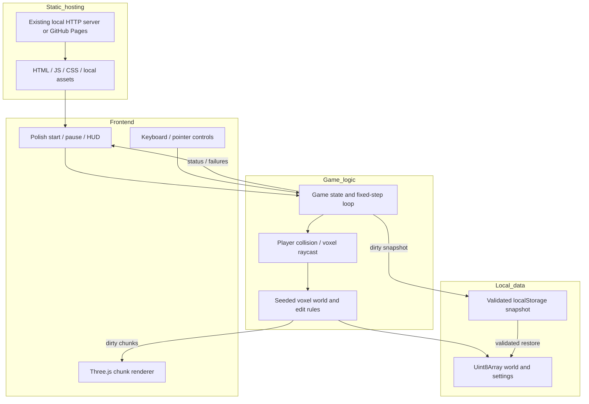
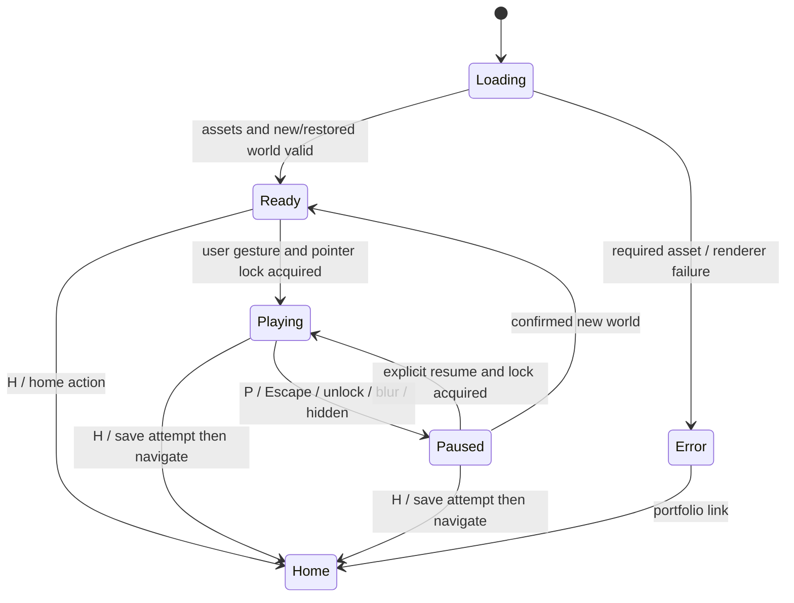

# Klocki Podlasia: browser voxel sandbox assessment and backlog

Assessment date: 2026-11-10. Updated: 2026-11-10.
Status: **phase-one local working model implemented; full feasibility gate pending**.

## Phase-one implementation and evidence

The user authorized phase one on 2026-11-10. That was interpreted as MC-001/MC-002:
an isolated working technical model, not the complete 0.1 production release.
The [playable prototype](../klocki-podlasia-0.1/) and its
[instructions](../klocki-podlasia-0.1/README.md) are now available from the portfolio.
Use <http://localhost:8765/klocki-podlasia-0.1/> with the repository server running.

Delivered: locally vendored Three.js r180, a seeded 64 x 32 x 64 world, original
trees/cottage, exposed-face chunks, collision-aware walking/jumping, five-block
picking, eight materials, removal/placement checks, safe recovery, Polish
start/pause/help, quality/sensitivity controls, reset confirmation and diagnostics.
There is deliberately **no save, sound, mobile gameplay or multiplayer**.
All worlds are temporary; the UI and portfolio say so.

One scoped adjustment: an explicit drag-to-look mode provides playable keyboard
Q/E editing when pointer lock is denied. Default captured-mouse play remains
available in supporting browsers. World replacement uses inline confirmation,
not a disruptive browser popup.

Observed local evidence on 2026-11-10:

- Nine Node logic tests passed, including 20 deterministic seed/spawn fixtures,
  exposed-face counts/winding, chunk-boundary edits, picking, overlap rejection,
  jumping, ceilings, removed support, normalized movement, wall tunnelling and
  world boundaries.
- VS Code embedded Chromium 150 / Electron 43 on macOS, actual CSS viewport
  1024 x 640, device pixel ratio 1.25: 60-second local session with 200 successful
  remove/place edits, 120 reported FPS, median frame 8.3 ms and p95 8.8 ms.
  Final draw calls 13, allocated geometries 14; first local rendered frame 44 ms.
  These are diagnostic samples, not throttled-network or reference-device targets.
- No uncaught page errors or failed resource requests in that edit fixture.
- Pointer-lock denial in the embedded browser is reported visibly and its rejected
  promise is handled. Real captured-mouse success is **not verified** here.
  Drag-to-look, keyboard movement, material selection, Q/E edits, P/Escape pause
  and safe recovery were exercised through browser input.
- A separate final-UI run completed 20 confirmed new-world cycles, plus cancel
  confirmation and low-resolution checks, with no uncaught errors. Allocated
  geometries ranged from 11 to 16, rather than increasing monotonically.
- All runtime dependencies are local; no build/install step was needed.
- Portfolio entry/home navigation and blur-pause/resume were checked; held input
  did not continue moving after resume. A deliberately blocked core module showed
  a clear load failure with disabled play controls and a working home link;
  removing the block and reloading restored play.

Still pending before G0 approval: named reference hardware, standalone Safari
and Chrome testing (including successful native mouse capture), actual hosted
project-path preview, network/latency budgets and owner approval of game feel.
Nothing has been committed, pushed or published as part of this phase.
The original plan below remains the release roadmap, not a claim that later
tasks or acceptance gates have been completed.

## 1. Recommendation and goal

Build a small, original, first-person 3D block-building game, provisionally
**Klocki Podlasia 0.1**. Players explore a small meadow, remove blocks and build
a cottage, garden or lookout tower using an unlimited palette. Give it the
collection's Polish, welcoming "Ekipa spod Lipy" identity rather than Minecraft
branding or copied content. The first release is a desktop creative sandbox,
not a survival game or a promise of Minecraft feature parity.

**Feasibility: good for this bounded scope.** Rendering cubes is straightforward;
reliable movement, editing, saving, browser input and sustained performance are
the real work. Start with a time-boxed proof before authorizing the full game.
The initial plan did not authorize implementation. The subsequent phase-one
authorization covers the local model above, not later production scope,
installations or publishing.

### Planning answer at a glance

| Outcome | Cumulative effort | What it establishes |
|---|---:|---|
| Scope and technical proof | 16-26 hours | Hosted 3D scene, rough movement/editing, initial browser measurements |
| Playable creative slice | About 90-145 hours | World, reliable walking/building, basic Polish UI; not release quality |
| Desktop 0.1, before contingency | 140-230 hours | Complete scope, saves, theme, integration and release checks |
| Desktop 0.1, with contingency | **175-310 hours** | Adds 25-35% for browser differences, tuning and rework |

These are person-hours for one experienced JavaScript developer using Copilot,
including focused tests, simple original art/audio and iteration. They are
estimates, not measurements or delivery commitments. At 30 productive hours/week,
budget roughly **6-11 weeks**; at 15 hours/week, **12-21 weeks**. Learning 3D
programming or substantial art revisions can increase the estimate by 1.5-2x.
The playable-slice checkpoint includes early UI work and is approximate, not a
second budget to add to the release estimate.

## 2. Repository assessment and fit

This assessment inspected source and documentation, not a running game or GPU
benchmark. No browser/device compatibility or performance result is claimed.

| Existing evidence | Consequence for this game |
|---|---|
| [Portfolio](../index.html): Polish title, Hajnówka/Podlasie identity, neon gradient, rounded accent-colour cards, gameplay thumbnails and "Graj" actions | Add one matching card when playable; retain the collection's shell, not a separate website |
| [Flappy Podlasie](../flappy-0.1/README.md) and its [styles](../flappy-0.1/style.css): meadow, wooden gates, green/cream/yellow palette, clear large controls | Use a welcoming Podlasie meadow and timber-building identity inside the game |
| [Maks Jump Quest](../mario-0.3/README.md): original assets, locally bundled engine, immediate browser play | Original low-resolution voxel art; local dependencies; no account or installation |
| [Flappy game logic](../flappy-0.1/game.js): explicit start, pause on backgrounding, local preferences and visible save warnings | Carry those UX expectations into the new game without coupling its code to Flappy |
| [Local server documentation](../README.md#-lokalny-serwer-gier-macos) and [server wrapper](../scripts/game-server.sh) | Reuse the existing HTTP server; ES modules will require HTTP, not direct file opening |
| [Archery planning index](./README.md) separates planning from existing releases | Keep this as an independent backlog, not an extension of the Unity archery plan or root castle backlog |

The root README's technology summary is broader/simpler than the actual code:
the collection includes Phaser games and a compiled Unity reference. There is
no reason to force a new 3D voxel game through Phaser's 2D gameplay model or to
adopt Unity just because another planned game recommends it.

Hosting references currently mix `dariusz22p.github.io` in documentation and
`daz2048.github.io` in portfolio metadata. Do not silently normalize those unrelated
references in this task. At release, confirm the actual destination and test the
new game's relative URLs beneath that site's `/gry-darka/` project path.

### Visual and content direction

- Working title: **Klocki Podlasia**; proposed directory: `klocki-podlasia-0.1/`.
- Bright daytime meadow, gentle hills, deciduous trees, timber cottages and
  optional simple fence patterns. Evoke Podlasie without needing photorealism.
- Grass green `#6fa857`, cream `#eff5ed`, timber brown `#87523b`, warm yellow
  `#ffcd53`; dark green `#183f36` text. Check actual contrast, especially HUD text.
- Portfolio card keeps the existing dark/neon layout, with a green/gold accent
  and an original gameplay preview. Do not reskin other games.
- Polish UI: "Graj", "Wznów", "Nowy świat", "Zapisz", "Dźwięk", "Menu gier".
  Use readable sans-serif HUD text; retro display text only where legible.
- Eight clearly labelled material slots, a small crosshair/target outline,
  optional control hints and a visible save state. Labels must not rely on colour.
- Small original building/breaking sounds and birds/wind only after a gesture.
  No autoplay soundtrack; M and a visible button mute everything immediately.
- Optional non-scored prompts such as "Zbuduj domek pod lipą"; no quest engine,
  reward economy or mandatory building detector in 0.1.
- Create our own textures, sounds, logo and terminology. Do not ship Minecraft
  artwork, audio, characters, code, UI imitation or imply Mojang/Microsoft approval.
  Record third-party licences alongside any approved assets.

## 3. Scope: what "simple Minecraft-like" means

### Must ship in desktop 0.1

1. Single player, first-person walking, looking and jumping with solid collisions.
2. One finite **64 x 32 x 64** voxel world: seeded hills, trees and a clear spawn.
   No infinite streaming, caves or fluid simulation.
3. Air plus eight opaque building materials: grass, earth, stone, trunk wood,
   leaves, sand, planks and roof tiles. Leaves are solid/opaque in this release;
   no transparent-material sorting or falling-sand physics.
4. Remove and place within **5 blocks** of the camera; highlight the exact target.
   Unlimited materials, instant edits with a controlled repeat rate, no tools,
   mining timers, inventory quantities or crafting recipes.
5. Reject placement through the player, out of bounds or beyond the target range.
   Protect the bottom world layer; show a clear explanation for rejected actions.
6. Safe spawn/respawn, explicit world boundaries and a confirmed "new world" action.
   Recovery must work even when a saved player location is obstructed.
7. Polish start/pause/help/settings UI, muted state, fullscreen where supported,
   sensitivity and reduced-motion options; no camera bob by default.
8. One local save slot containing world, player, palette selection and settings.
   Reload restores it; unavailable/corrupt/full storage has visible handling.
9. Portfolio card, preview, README and self-hosted runtime assets.
10. Current stable desktop Safari, Chrome and Firefox tested at release; record
    exact versions/hardware. Do not inherit the collection's mobile support claim.

### Explicitly not included

Survival, combat, health/hunger, mobs, weapons, crafting, tools, drops, redstone,
water/lava, day/night, weather, procedural caves, endless worlds, multiplayer,
accounts, chat, cloud saves, modding, VR, native apps, advertisements and analytics.
No mobile gameplay or offline-installable PWA promise in 0.1. Static assets being
self-hosted does not guarantee offline browser caching.

### Routes considered

| Route | Fit and trade-off | Effort guidance |
|---|---|---|
| 2D side-view block builder using existing Phaser | Cheapest alternative; matches platformers but not first-person 3D | Roughly 60-110 hours before contingency; a separate reduced specification |
| **Three.js + small voxel systems** | Recommended: editable JS, small static deployment, direct control over bounded scope | 140-230 hours before contingency, itemized below |
| Babylon.js | Viable 3D alternative with more built-in facilities; not an existing repo dependency | Same broad order of effort; no demonstrated saving without a spike |
| Unity Web export | Viable if Unity authoring is a separate goal; setup/export overhead unnecessary here | Re-estimate if selected; do not reuse the archery estimate |
| Full Minecraft-like survival/infinite/multiplayer game | Fundamentally different scope with ongoing content/operations work | Months to years; not covered by the 0.1 estimate |

Do not build a rendering engine or adopt an unreviewed open-source clone solely
to get a quick screenshot. Rendering libraries do not provide voxel game rules.

## 4. Technical implementation design

### Stack and deployment

- Vanilla JavaScript ES modules, HTML and CSS, matching the repository's low-setup
  approach. JSDoc and small modules rather than introducing React/TypeScript tooling.
- Three.js `WebGLRenderer`, a perspective camera and `PointerLockControls` for
  mouse-look. Implement voxel collisions and gravity ourselves; camera controls
  are not a character-physics engine.
- Target WebGL2-capable desktop browsers; detect renderer creation failure and
  show a helpful Polish message plus a portfolio link. No WebGPU requirement or
  hidden WebGL1 compatibility promise.
- Pin a tested Three.js release at kickoff; vendor the module files and required
  transitive imports/addon together, retaining MIT licence and version provenance.
  Use a local import map; test that no bare imports or CDN requests remain.
- Serve plain files with the existing HTTP server and GitHub Pages. No backend,
  tRPC/API endpoints, authentication, database server, Docker, cross-origin
  isolation or custom hosting headers are needed. Do not introduce them.
- Use relative asset/navigation URLs so localhost and the project subpath work.
  Direct `file://` loading is unsupported and must display or document the HTTP
  route; do not promise an inline fallback when modules cannot load.
- Keep each existing game/release unchanged. Prefer an isolated folder over a
  shared framework refactor. Future releases can follow the repository's version
  folder convention; storage migrations must be deliberate rather than automatic.

Proposed layout (not files created by this planning task):

```text
klocki-podlasia-0.1/
  index.html, style.css, README.md, preview.svg
  game.js              # startup, state transitions, lifecycle
  config.js            # dimensions, palette and tuning
  world.js             # voxel data, generator, edit rules
  renderer.js          # chunks, geometry, target highlight, disposal
  player.js            # movement, collisions, spawn and picking
  input.js             # keyboard/mouse capture and clearing
  ui.js, audio.js       # Polish DOM controls and sound
  storage.js           # validated versioned local snapshot
  tests/               # logic fixtures and browser smoke checks
  assets/              # original small textures, if needed
  vendor/              # pinned Three.js runtime/addon and licence
```

Module boundaries can be combined if that simplifies implementation; avoid both
one giant HTML script and a general-purpose voxel engine framework.



### World, rendering and simulation

- Store block IDs in a `Uint8Array`: **131,072 bytes (128 KiB)** for the proposed
  world. Distinguish array memory from much larger CPU/GPU geometry allocations.
- Split into **16 x 16 x 16** chunks: 32 chunks total. Build faces only where
  a solid block borders air. Use one opaque atlas/material, nearest filtering,
  lightweight directional/ambient lighting and fog; no real-time shadows initially.
- Do not create a mesh, physics body or draw call for every voxel. Simple
  exposed-face geometry is enough initially; greedy meshing/workers are later
  responses to measured problems, not mandatory architecture.
- Edits mark the owning chunk and affected face-neighbours dirty. Rebuild only
  affected geometry, coalesce repeated edits and dispose replaced GPU buffers.
  Avoid rebuilding every chunk on every pointer event.
- A fixed 60 Hz simulation, bounded catch-up steps and a clamped elapsed time
  prevent huge jumps after backgrounding. Rendering runs independently.
- Axis-separated player AABB/voxel collisions with bounded movement substeps.
  Normalize diagonal movement, cap fall speed, handle ceiling/edge collisions.
  Test maximum permitted speed at the slowest supported frame rate.
- Use grid DDA traversal for picking from the camera, not an unbounded raycast
  through thousands of cube meshes. Return the first solid cell and entry face;
  that determines the remove cell and adjacent placement cell.
- Protect y=0, stop at x/z edges and above the height limit, and provide an
  explicit "Wróć na start" recovery action. No invisible wrapping or forced reset
  of the world to recover the player.
- Seeded generation must produce a safe spawn with headroom. Ensure all approved
  seeds can be used without trapping the player in a trunk or an unreachable pit.
- Cap render pixel ratio at 1.5 initially; expose a low-quality preset (1.0).
  Resize canvas/camera without stretching; never change game speed with FPS.

### Controls and the important Escape exception

| Action | Proposed desktop binding |
|---|---|
| Start/resume and request pointer lock | Explicit "Graj"/"Wznów" click |
| Move / jump / look | WASD or arrows / Space / mouse |
| Remove / place | Left mouse / right mouse; keyboard Q / E equivalents |
| Select material | 1-8, mouse wheel, or labelled palette buttons |
| Pause | P; pointer unlock, window blur or hidden tab also pause |
| Sound / fullscreen | M / F plus visible buttons |
| Return to portfolio | H or "Menu gier"; flush pending save or show failure |
| Recover position / new world | Separate pause-menu actions; new world confirmed |

Existing games advertise Esc/H as immediate portfolio navigation. Pointer lock
uses Escape to release the mouse, so **Escape pauses/unlocks here, it does not
navigate**. This is an intentional exception, not a race between two handlers.
Update the root README's universal shortcut claim at implementation time and
explain the exception in game instructions. H remains direct home navigation.
Do not make a second Escape press unexpectedly discard the session.

Pointer lock may be denied or unavailable. Show a clear retry/instructions state
and leave the home link usable; do not treat it as successful gameplay. Capture
only after a gesture, clear held inputs on every unlock/blur, and never let a
menu-closing click remove a block. UI clicks/typing must not trigger gameplay.
Suppress the context menu only over the active playfield. Fullscreen is optional;
denial leaves a playable windowed game with a visible explanation.



### Local data contract and failure handling

Use one namespaced key, provisionally `klocki-podlasia-v1`. Do not read, clear or
overwrite another game's settings. There is no relational schema, foreign key,
database migration service or HTTP API: module contracts and a snapshot suffice.

| Field | Type/constraint |
|---|---|
| `schemaVersion` | Integer 1; reject unsupported future versions without overwriting |
| `generatorVersion`, `seed` | Pinned generator identifier and bounded integer seed |
| `dimensions` | Exactly [64, 32, 64] for schema 1 |
| `blocks` | Base64-encoded full byte array; exactly 131,072 decoded valid block IDs |
| `player` | Finite bounded position/yaw/pitch; validate collisions and recover safely |
| `selectedBlock` | One of the eight placeable IDs |
| `settings` | Validated mute, bounded sensitivity, quality and reduced-motion values |

Full snapshots are simpler and bounded here; no diff log, cloud sync or IndexedDB
is needed initially. Base64 voxel bytes take about 175 KB; cap the entire encoded
save at **256 KiB** and validate length before decoding. A later world-size increase
requires revisiting this choice, not silently growing synchronous writes.

Save only dirty state, debounced to at most once per 3 seconds, plus explicit
save and best-effort pause/home flush. Show "Zapisywanie", "Zapisano" or a useful
failure message; never claim an unload handler guarantees a completed save.
Keep the last valid save on validation/generation failure. Corrupt or unsupported
saves require an explicit choice to start a temporary world or confirm replacement;
never silently erase them. Quota/denied-storage failures leave an explicitly
unsaved playable session, with a warning that changes will be lost on exit.
Backup export/import and multiple slots are deferred rather than half-supported.

Internal operations should have small tested boundaries: generate/read/edit world,
step player, pick block, build dirty chunks, validate/load/save snapshot, pause and
dispose. Report errors to visible UI and diagnostic console without dumping save
contents. No accounts, names, analytics, remote persistence or tracking are needed;
browser storage stays on the device and is cleared by site-data removal.

## 5. Detailed implementation backlog

MC-001 has a provisional bounded scope; reference hardware and final owner
approval remain open. MC-002 has a working local model; its hosted/browser gate
is pending. Later tasks are not accepted as complete, even where this prototype
contains preliminary implementations. Dependencies are prerequisites, not merely
the preceding row. Estimates below are original planning budgets, not measured
time spent or an updated remaining-work forecast.

| ID | Deliverable | Dependencies | Hours |
|---|---|---|---:|
| MC-001 | Freeze scope, art brief and reference test hardware | None | 4-6 |
| MC-002 | Time-boxed hosted 3D feasibility proof | MC-001 | 12-20 |
| MC-003 | Deterministic bounded world and edit model | MC-002 gate passed | 14-22 |
| MC-004 | Production chunk meshing and rendering lifecycle | MC-003 | 16-26 |
| MC-005 | Reliable player, picking and safe recovery | MC-003 | 18-30 |
| MC-006 | Complete building interaction and palette | MC-004, MC-005 | 14-22 |
| MC-007 | Polish shell, pause, controls and settings | MC-002 gate passed | 10-16 |
| MC-008 | Versioned local save and visible failure paths | MC-003, MC-005, MC-007 | 12-20 |
| MC-009 | Original Podlasie presentation and audio | MC-006, MC-007 | 14-24 |
| MC-010 | Portfolio, preview, documentation and static deployment | MC-007, MC-009 | 4-8 |
| MC-011 | Browser regression, performance hardening and release | MC-006, MC-008, MC-009, MC-010 | 22-36 |
| | **Subtotal** | | **140-230** |

### MC-001 - Agree a buildable game

- [ ] Confirm desktop-first 3D, eight materials, world size and exclusions.
- [ ] Approve the working title, original visual brief and Escape exception.
- [ ] Name the reference Mac, display resolution and desktop browser versions.
- Acceptance: one bounded feature checklist; no "everything Minecraft has";
  mobile and survival cannot silently enter the desktop budget.

### MC-002 - Prove the highest-risk path first

- [ ] Vendor a pinned library and licence; serve modules via the existing server.
- [ ] Generate a representative world; implement rough walk/look, one edit,
  exposed-face chunks and pointer-lock/pause handling.
- [ ] Load on Safari and Chrome over localhost and a hosted project-path preview.
  Publishing a preview remains a separately authorized step; if unavailable,
  record the hosted part of the gate as pending, not passed.
- [ ] Record first-frame timing, frame times/draw calls and repeated edit behaviour.
- Acceptance: walk, edit and pause without console errors or missing resources;
  hardware measured against section 6's initial targets. This proves direction,
  not production collision/save correctness.
- **G0:** stop at 20 spike hours (26 including MC-001). If failing, report the
  fixture/measurements and choose smaller world/lower quality, a re-estimated
  investigation, or the 2D fallback. Do not continue adding features to a failed core.

### MC-003 - Own the world model

- [ ] Implement block definitions, coordinates/indexing, bounds, protected floor,
  seeded terrain/trees, safe spawn and deterministic generation.
- [ ] Keep world logic independent of DOM/Three.js for cheap unit tests.
- Acceptance: identical seed/version gives identical bytes; differing approved
  seeds vary terrain; every tested spawn has support/headroom. Bounds, invalid
  block IDs, protected floor and chunk-boundary edits have explicit fixtures.

### MC-004 - Make rendering sustainable

- [ ] Add atlas/face shading, frustum-friendly chunk meshes, dirty scheduling,
  resize/pixel-ratio settings and proper disposal.
- Acceptance: an isolated cube produces 6 quads, two adjacent cubes 10, and a
  solid 16-cube chunk 1,536 exposed quads before any optional greedy merging.
  Cross-chunk edits reveal/hide the correct neighbour faces with no seam.
  Repeated rebuild/reset cycles do not accumulate live chunk geometries.

### MC-005 - Make movement and selection trustworthy

- [ ] Ground/air movement, gravity, jump, ceiling contact, substeps and boundaries.
- [ ] Grid ray traversal, maximum reach, safe respawn and obstructed-save recovery.
- Acceptance: no tunnelling at configured maximum speed under a 30 FPS fixture;
  no double jump, diagonal speed boost or background-tab leap. Ray fixtures cover
  axis-aligned/negative directions, boundary ties, empty reach and correct face.
  Returning to spawn never modifies the world.

### MC-006 - Finish the creative loop

- [ ] Remove/place rules, target outline, eight slots, wheel/buttons/keys,
  input repeat throttling and explicit rejected-action feedback.
- Acceptance: 200 mixed edits, including cross-chunk/corner edits, remain accurate;
  player overlap, protected floor, out-of-bounds and unreachable edits are rejected.
  Held clicks stop immediately on pause; resume does not perform an accidental edit.
- **G1:** with basic MC-007 UI available, three new players can start, build a small
  recognizable structure and resume after Escape. Record confusion and revise
  controls before presentation/content expansion.

### MC-007 - Integrate the collection's UX

- [ ] Implement the state diagram, gesture capture, start/help/pause, home,
  new-world confirmation, sound/settings buttons and optional fullscreen.
- [ ] Clear input on every lifecycle transition; accessible DOM buttons, focus
  indicators and explanatory text for unsupported/denied browser capabilities.
- Acceptance: 20 pause/resume/restart cycles do not duplicate listeners/loops.
  Escape pauses only; H/home navigates; pointer-lock denial remains recoverable;
  no gameplay key fires while interacting with a menu. Interface fits 1280x720
  and compact 800x600 desktop windows. Do not claim screen-reader access to the
  entire 3D world; menus and statuses should remain operable and labelled.

### MC-008 - Protect a player's creation

- [ ] Snapshot schema/validation, safe restore, dirty autosave, explicit save,
  save-status UI and confirmed replacement/reset of this game's data only.
- Acceptance: a constructed world and settings survive reload byte-for-byte;
  obstructed player position recovers. Test denied/quota storage, malformed JSON,
  oversized base64, wrong dimensions/length, invalid IDs, nonfinite positions and
  future schemas. None silently overwrite the previous save or report success.
  Record synchronous save time against the section 6 budget.

### MC-009 - Give it an original identity

- [ ] Meadow/tree/cottage palette, original low-resolution surfaces, readable
  toolbar, target outline, simple synthesized effects and optional ambience.
- [ ] Mute applies to all sound; start/resume requires a gesture; quality and
  reduced-motion settings take effect immediately.
- Acceptance: human review approves a recognizably Podlasie-themed original game;
  no Minecraft assets/branding. Missing optional sound does not block building,
  and essential visual/UI failures are not swallowed. Test sound with mocks first;
  audible validation only in a separately approved quiet-work-safe window.

### MC-010 - Add the game without disturbing the collection

- [ ] Add the green/gold card, accurate Polish description, preview with alt text,
  and link to the new folder; no unfinished "Graj" destination.
- [ ] Document controls, desktop-only support, local data/reset semantics,
  HTTP startup, dependency licence and the deliberate Escape exception.
- [ ] Update the root shortcut guidance and available-games entry; verify both
  local and actual hosted subpaths with local runtime assets.
- Acceptance: new card loads its own game, home returns to portfolio, assets
  resolve without a CDN; existing cards, version folders and saves are unchanged.
  Font failure has a local fallback. No root-scope service worker is introduced.

### MC-011 - Measure, repair and release

- [ ] Complete the section 6 matrix, fault injection, long edit/reset session and
  human playtest fixes; retain exact versions, device, viewport and measurements.
- [ ] Capture a representative preview; verify clean deployment and third-party
  notices. Document known limits rather than hiding unsupported cases.
- Acceptance: all must-haves pass on the agreed browsers, no unexplained errors,
  and performance/storage budgets pass or are explicitly revised before release.
- **G2:** owner approves game feel, scope and release evidence; only then authorize
  publication. A localhost demo is not hosted release evidence.

## 6. Verification and measurable budgets

Targets below are proposed acceptance criteria, **not measured results**. Confirm
the reference device/network at MC-001, measure at G0 and recheck the final game.

| Area | Initial acceptance target / evidence |
|---|---|
| Cold start | Interactive within 5 seconds at 20 Mbps / 50 ms RTT, empty cache; initial transferred assets <= 3 MiB |
| Rendering | 1280x720 viewport, DPR capped at 1.5; median frame <= 16.7 ms and p95 <= 33.3 ms over a 60-second walk/edit fixture |
| Low quality | Repeat at DPR 1.0; if required for a passing reference-device result, disclose that requirement |
| Editing | p95 input-to-visible edit <= 100 ms over 200 edits; no edit creates a >100 ms main-thread stall |
| Draw calls | <= 100 in the representative world including UI/target helpers; inspect renderer counters |
| Lifecycle | 20 new-world/reload cycles and 10-minute edit session; no monotonic growth in retained chunk geometries/textures |
| Save | Encoded snapshot <= 256 KiB; p95 write <= 50 ms across 20 dirty saves; failures visible |
| Determinism | At least 20 seed fixtures, identical bytes for repeated seed/version; all safe spawns |
| Browser failures | Missing module/texture, unavailable WebGL2, denied lock/fullscreen and storage errors show actionable UI/home route |

Keep test tools light: pure-JS deterministic unit tests using a standard runner
selected at kickoff; a small browser smoke suite for DOM/input/storage/rendering.
Do not install a toolchain merely to write this plan. No existing game-test runner
was established by this assessment, so do not claim new tests already fit one.

Browser matrix:

- Safari, Chrome and Firefox on the named desktop Mac: start, movement/jump,
  remove/place, pause/unlock, tab switch, resize, mute, fullscreen, save/reload,
  corrupt/blocked storage, new-world confirmation and home.
- Chrome/Edge on Windows: one real-device smoke pass before claiming Windows
  support; Mac browser coverage alone is not evidence for it.
- Test localhost **and** the actual Pages project path, including cold-cache
  module/asset loading. Optional fonts failing must not stop play.
- Test unsupported touch/mobile entry: truthful desktop-controls message and a
  usable home link, not an apparently playable screen with missing controls.
- Automated/audio tests stay silent by mocking Web Audio. Any actual sound
  playback needs an explicitly approved away-from-Mac window.

If budgets fail, first reduce render scale/decoration, inspect geometry churn and
coalesce dirty work. Consider greedy meshing or a worker only with a measured
bottleneck and a revised estimate. Do not certify performance just by showing FPS
in an empty world or averaging away long edit stalls.

## 7. Risks, later options and ownership

| Risk | Mitigation / decision |
|---|---|
| "Simple" grows into Minecraft parity | Freeze exclusions; separately estimate each new system |
| First-person controls confuse players or cause discomfort | Explicit onboarding, sensitivity, no camera bob, small G1 playtest |
| Safari input/WebGL differences | Prove Safari at G0; visible capability failures, no auto-lock loops |
| Geometry churn or synchronous save stutters | Bounded world, dirty chunks, disposal, measured save/frame budgets |
| Local storage is cleared or unavailable | Honest local-only warning and unsaved state; backup feature later |
| Browser-close loses the last few seconds | Dirty autosave and visible status; no guaranteed unload-save promise |
| Original art/audio takes longer than placeholders | Approve a small style sample early, keep eight materials and one biome |
| Existing global shortcut claim conflicts with pointer lock | Document and test the Escape exception, retain H/home |
| Old versions share a hosting origin | Unique save key; never broad-clear storage or add root-scoped caching |

Potential additions are **not included** in the desktop estimate. Very preliminary
incremental engineering budgets, before 25-35% contingency and device/asset costs:

| Later option | Additional hours | Why separate |
|---|---:|---|
| Real mobile/touch release | 40-80 | Dual-stick/look gestures, action buttons, browser limitations, lower GPU budget and real-device QA |
| Export/import and multiple local slots | 12-24 | File validation, backup/recovery UX and save selection |
| Small crafting/inventory loop | 35-70 | Resource rules, recipes, new UI, balancing and persistence changes |
| Simple day/night and one creature | 40-90 | Lighting, animation/AI, collision and meaningful behaviour; not survival parity |
| Per-game offline/PWA support | 12-24 | Cache/update recovery and isolation; no root service worker |
| Multiplayer | 150-350+ | Server-authoritative edits, synchronization, reconnect/conflicts, hosting and abuse controls; re-scope first |

These extensions are low-confidence sizing signals, not additive commitments:
interactions can change the architecture and require a fresh plan. In particular,
multiplayer is not "just add WebSockets" and does not belong in a static-only MVP.

Copilot can implement modules, tests, procedural placeholders and deployment
checks. Human involvement remains necessary for visual direction, game feel,
real-device testing, original-asset approval and publishing authorization.
The next recommended action is **MC-001 followed by the bounded MC-002 proof**,
not installing Unity or immediately building all optional features.

## 8. Technical references

Repository observations are linked in section 2. Public Three.js documentation
was consulted for this assessment; select and verify the actual pinned release
at implementation time rather than treating a moving documentation page as a lockfile.

- [Three.js installation and local module/import-map setup](https://threejs.org/manual/en/installation.html)
- [Voxel geometry: exposed faces and neighbouring-cell rebuilds](https://threejs.org/manual/en/voxel-geometry.html)
- [PointerLockControls and lock/unlock lifecycle](https://threejs.org/docs/pages/PointerLockControls.html)
- [WebGLRenderer and rendering configuration](https://threejs.org/docs/pages/WebGLRenderer.html)
- [Resource cleanup and disposal](https://threejs.org/manual/en/cleanup.html)
